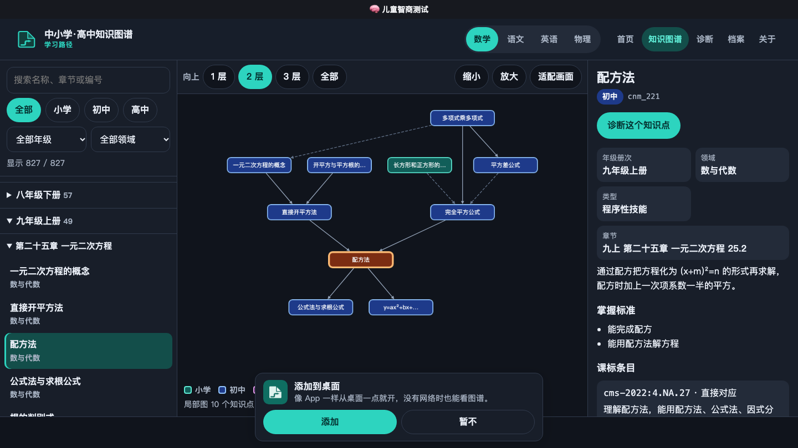
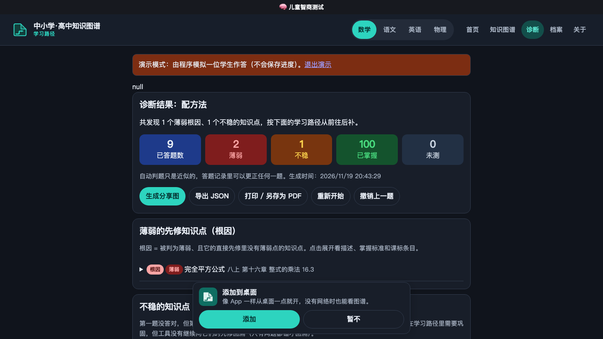
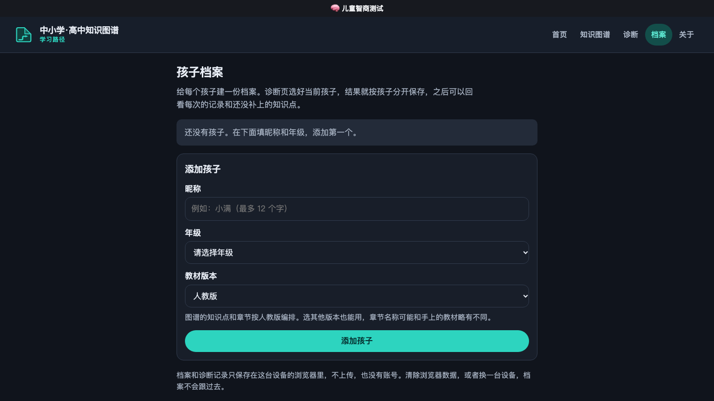

# 中小学·高中知识图谱（DSH Desktop 工作台）

把开源静态知识图谱站 [xiaoyang111222/cn-math-taxonomy](https://github.com/xiaoyang111222/cn-math-taxonomy) 完整打包为 [DSH Desktop](https://dshdesktop.com/) 工作台：**知识图谱浏览、自适应前置诊断、孩子档案**，全部页面与题库内置于包内，安装即用，不依赖外部站点。


## 功能

- **知识图谱**：数学（小学到高中）、英语、物理、语文共 2222 个知识点、3453 条先修边；搜索知识点，查看局部先修图（Cytoscape + dagre）、课标条目、掌握标准，并可一键对该知识点发起诊断。
- **自适应诊断**：选整册/整年级或单个知识点，逐题作答（每点最多 2 题）；答对推断掌握，答错沿先修边回溯到具体的小学知识点，给出薄弱根因和按年级排序的学习路径，支持按章汇总。
- **孩子档案**：给每个孩子建档，诊断结果按孩子分开保存（仅存本机浏览器 localStorage）。
- **AI 讲解**：可把当前诊断结果带入工作台会话，让 AI 解释薄弱根因与学习路径。

| 首页 | 知识图谱 | 诊断演示 | 孩子档案 |
| --- | --- | --- | --- |
|  |  |  |  |

## 安装

在 DSH Desktop 的工作台市场中搜索「中小学知识图谱」安装；或手动安装 GitHub Release 中的 `dsh-k12-diagnose-workbench.tgz`。

## 开发

```bash
pnpm install        # 安装 peer 依赖（@deepseek-ai/cordis、@deepseek-ai/schemastery）
pnpm build          # 由 src/client.js 生成 lib/client.js
pnpm test           # 7 项自测（数据、引擎、清单、客户端、路由）
pnpm pack           # 打包 .tgz
```

包结构：`dsh/index.js` 服务端（把 `site/` 以 `/k12-site/*` 精确路由托管在宿主 webServer 上）；`lib/client.js` 客户端（注册工作台面板，iframe 嵌入 `/k12-site/`，带可拖拽对话列与加载失败可见横幅）；`site/` 原站全部页面、依赖库与数据。

## 网络与数据

- 图谱数据、题库、页面与依赖库全部打包在本地，诊断在本机浏览器内完成，不上传任何用户数据。
- 页面保留了原站自带的一处外部请求：原作者的匿名访问统计（`site/assets/stats.js` → `math-pansgo-stats.*.workers.dev/collect`，仅页面浏览事件）。除此之外页面不加载任何外部资源。
- 站点内的外链（GitHub 仓库、在线演示站）为原站自带。

## 数据来源与许可

- 工作台壳代码（`dsh/`、`lib/`、`src/`、`test/`、`build.mjs` 等）以 **MIT** 许可发布（见 [LICENSE](LICENSE)）。
- 内嵌的 `site/` 目录（知识图谱数据、题库、页面与诊断引擎，来自 [xiaoyang111222/cn-math-taxonomy](https://github.com/xiaoyang111222/cn-math-taxonomy)）保留原作者的 **CC BY-NC 4.0** 许可（见 [site/LICENSE](site/LICENSE)）：非商业使用，再分发须保留署名与原作链接；因此**打包分发的安装包整体按 CC BY-NC 4.0 提供**，商用需原作者授权。
- 图谱与题库为 AI 生成的初稿，未经教师审核；先修关系与诊断结果仅供学习参考。
- Cytoscape、dagre、cytoscape-dagre、qrcode 依赖库保留各自 MIT 许可（见 `site/assets/vendor/`）。
